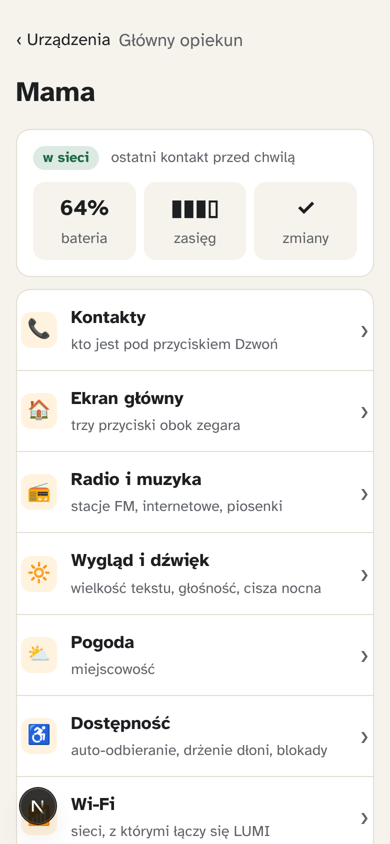
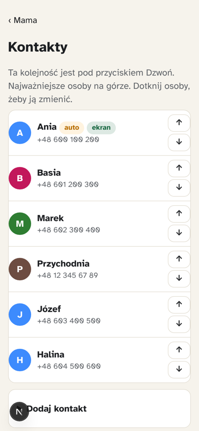
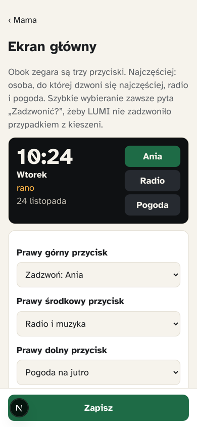
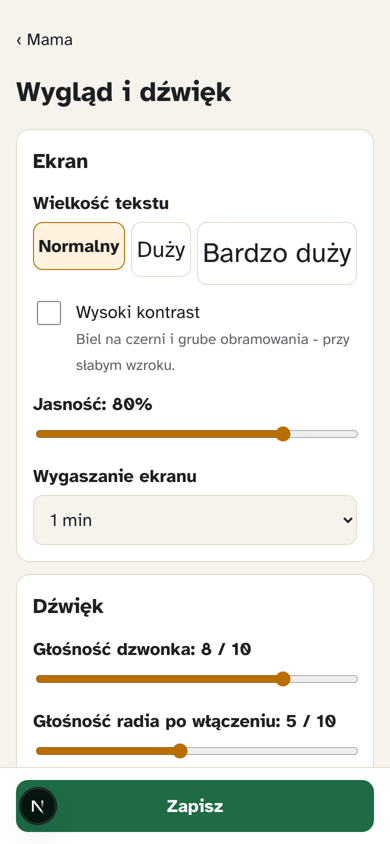

# LUMI - aplikacja rodziny

Aplikacja webowa instalowana na telefonie jak zwykła aplikacja (PWA): jedna dla Androida, iPhone'a i komputera, bez sklepów. Next.js 15 + Supabase (logowanie, baza, pliki muzyki).

| Urządzenie | Kontakty | Ekran główny | Wygląd i dźwięk |
| --- | --- | --- | --- |
|  |  |  |  |

## Wypróbuj bez Supabase (tryb demo)

```bash
npm install
LUMI_DEMO=1 NEXT_PUBLIC_SUPABASE_URL=https://demo.invalid NEXT_PUBLIC_SUPABASE_ANON_KEY=x SUPABASE_SERVICE_ROLE_KEY=x npm run dev
```

Otwórz http://localhost:3000. Jesteś zalogowana jako Ania, opiekunka LUMI "Mama". Dane leżą w pamięci i znikają po restarcie. Zapisy przechodzą przez te same akcje serwera i walidację co w prawdziwej wersji. Tego trybu nie włączaj na serwerze publicznym.

## Co umie

- **Logowanie kodem z e-maila**, bez hasła. Kod zamiast linku, bo link na iPhonie otwiera Safari, a nie zainstalowaną aplikację.
- **Parowanie**: telefon skanuje zwykłym aparatem kod QR z ekranu LUMI i od razu otwiera `/pair`. Pierwsza osoba zostaje głównym opiekunem, a jej numer może od razu trafić na przycisk ekranu głównego.
- **Ustawienia**: kontakty z kolejnością i auto-odbieraniem, trzy przyciski ekranu głównego (z podglądem), radio FM i internetowe, wgrywanie MP3 z telefonu, wielkość tekstu, kontrast, głośność, godziny ciszy, dostępność (drżenie dłoni, tryb jednego przycisku, blokady, odbieranie tylko od kontaktów), pogoda z wyszukiwarką miejscowości, sieci Wi-Fi.
- **Role**: główny opiekun ma dostęp do wszystkiego; rodzina - do kontaktów, ekranu, radia, wyglądu, pogody i Wi-Fi; znajomi - tylko do radia i muzyki. Zaprasza się e-mailem.
- **Stan urządzenia**: bateria, zasięg, ostatni kontakt, czy ostatnia zmiana już dotarła. Bez lokalizacji i historii słuchania.
- **Zdjęcia kontaktów**: zdjęcie robi się telefonem albo wybiera z galerii. Przeglądarka je zmniejsza, a serwer kadruje na twarz i przygotowuje obraz w formacie ekranu LUMI. Zdjęcia leżą w prywatnym koszu: LUMI pobiera je z sekretem urządzenia, a w aplikacji widzą je tylko członkowie rodziny.
- **Wiadomości**: krótki tekst (do 120 znaków) pojawia się na LUMI na cały ekran. Gdy ktoś naciśnie "Dobrze", w aplikacji widać godzinę przeczytania. Jeśli autor jest w kontaktach, LUMI pozwala od razu do niego oddzwonić. Wiadomości mogą wysyłać wszystkie role, także znajomi.
- **Przypomnienia**: np. leki o 8:00 w dni robocze. LUMI pokazuje je na cały ekran z dźwiękiem, aż ktoś naciśnie "Zrobione" (można odłożyć 2 razy po 10 minut). Na pulpicie widać, co dziś zostało potwierdzone. Gdy nikt nie potwierdzi, przychodzi powiadomienie.
- **Powiadomienia push**: słaba bateria (20% i 10%), brak karty SIM, brak zasięgu, LUMI bez połączenia od 2 godzin i ponowne połączenie. Każde przejście progu daje jedno powiadomienie, więc rodzina nie dostaje ich co 5 minut. Na iPhonie działają po dodaniu aplikacji do ekranu początkowego (iOS 16.4+).
- **Aktualizacje oprogramowania**: `firmware/tools/release.py` dodaje podpisane wydanie, a urządzenia instalują je w nocy (`/api/device/firmware`). Wersję i ostatnie błędy urządzenia opiekun widzi w panelu "Diagnostyka".
- **Historia zmian**: każde zapisanie składa zdanie, które LUMI pokaże użytkownikowi, np. „Ania dodała kontakt Basia”. Formę czasownika każdy wybiera w profilu.

## Jak to działa

```
telefon (PWA) --zapis--> serwer Next.js --> Supabase (ustawienia, wersja, historia)
LUMI --co 20 s, HTTPS + sekret urządzenia--> /api/device/config  (304 albo nowy dokument)
LUMI --co 5 min i po zmianie-------------> /api/device/status
```

- Każdy zapis przechodzi przez `src/lib/store.ts`. Ten moduł sprawdza rolę, waliduje dane tym samym zakresem co firmware (`src/lib/schema.ts`), podbija wersję i chroni przed nadpisaniem cudzej zmiany.
- Kontrakt z firmware sprawdzają testy: `shared/config-contract.json` generuje test aplikacji, a parsuje test firmware (`pio test -e native`).
- RLS jest włączone bez żadnych zasad: przeglądarka nie ma dostępu do tabel, wszystko idzie przez serwer z kluczem serwisowym.

## Uruchomienie

1. **Supabase**: utwórz projekt i w SQL Editor uruchom `supabase/schema.sql`.
2. **Logowanie kodem**: Authentication -> Email Templates -> "Magic Link". W treści szablonu musi być `{{ .Token }}`, np. „Twój kod do LUMI: {{ .Token }}”. Do testów wystarczy wbudowana poczta Supabase, w produkcji trzeba podpiąć własny SMTP.
3. **Zmienne**: skopiuj `.env.example` do `.env.local` i uzupełnij wartości z Project Settings -> API.
4. **Lokalnie**: `npm install && npm run dev`.
5. **Wdrożenie**: Vercel -> import repozytorium, katalog `app`, te same zmienne środowiskowe.
   - **Powiadomienia**: `npx web-push generate-vapid-keys`, wynik wpisz do `NEXT_PUBLIC_VAPID_PUBLIC_KEY` i `VAPID_PRIVATE_KEY`, ustaw też `CRON_SECRET`.
   - **Uwaga - harmonogram**: `vercel.json` sprawdza co godzinę, czy któreś LUMI nie straciło połączenia. Darmowy plan Vercel (Hobby) uruchamia harmonogram najwyżej raz dziennie. Wtedy zamiast niego użyj Supabase (Database -> Extensions: `pg_cron` i `pg_net`):

     ```sql
     select cron.schedule('lumi-offline', '*/30 * * * *', $$
       select net.http_get('https://TWOJ-ADRES/api/cron/offline',
         headers := '{"Authorization": "Bearer TWOJ_CRON_SECRET"}'::jsonb) $$);
     ```
6. **Urządzenie**: wpisz adres aplikacji w `firmware/platformio.ini` (`-DLUMI_SERVER=\"https://...\"`). Można go też podać na stronie 192.168.4.1 przy konfiguracji Wi-Fi albo w konsoli: `server https://...`.

Na telefonie: otwórz adres aplikacji, potem "Dodaj do ekranu początkowego" (iPhone: Udostępnij -> Do ekranu początkowego).

```bash
npm test          # schemat, kontrakt z firmware, zdania o zmianach, protokół urządzenia, aktualizacje, powiadomienia
npm run build
npm run e2e       # klikanie aplikacji w przeglądarce (tryb demo): pulpit, kontakty, przypomnienia, wiadomości
```

## Świadomie na później

- **Powiadomienie urządzenia w kilka sekund** (MQTT albo Supabase Realtime). Teraz LUMI pyta co 20 s.
- **Propozycje kontaktów od znajomych** do akceptacji opiekuna.
- **Fabryczne klucze urządzeń.** Teraz urządzenie rejestruje swój sekret przy pierwszym połączeniu (zaufanie przy pierwszym użyciu).
- **Hasła Wi-Fi w bazie** leżą jawnie w ustawieniach, bo urządzenie musi je dostać. Dostęp do nich ma tylko serwer, ale w produkcji warto je szyfrować.
- **Ograniczanie liczby zapytań** do API urządzenia.
