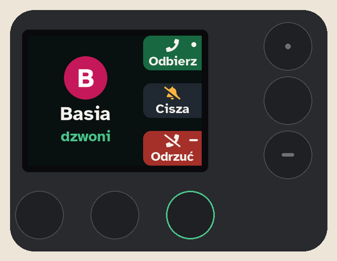
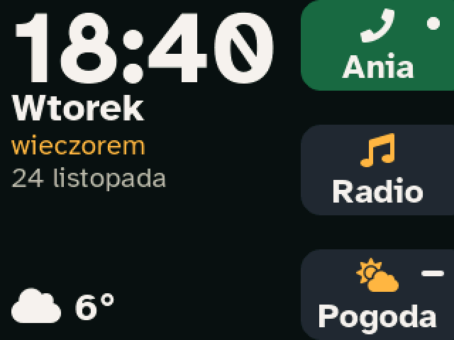
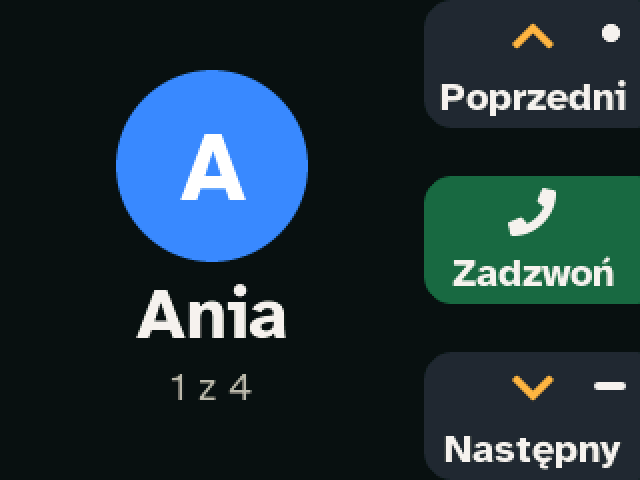
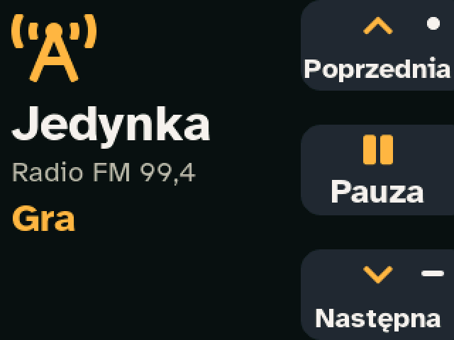
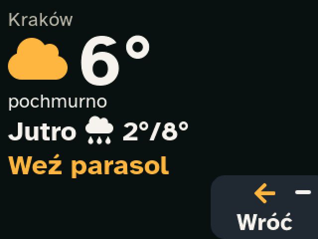
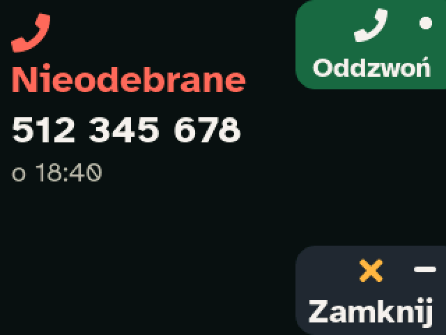
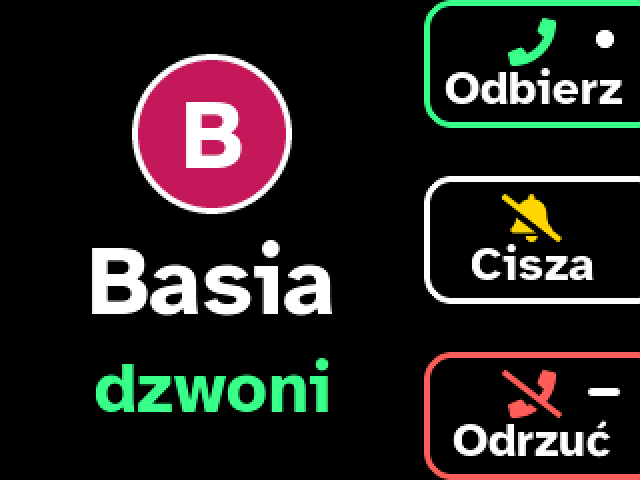
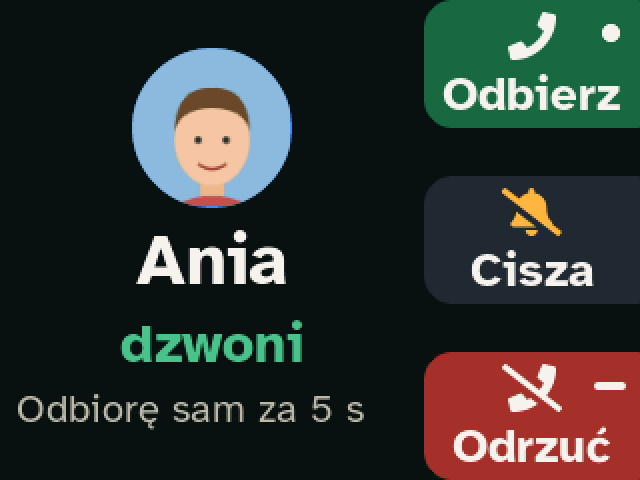
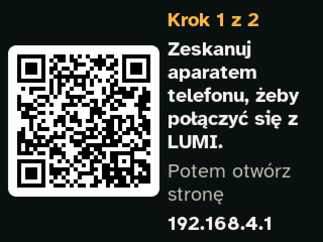
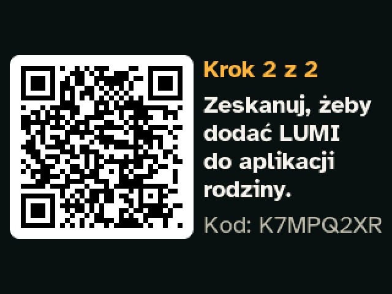

# LUMI Pocket - oprogramowanie prototypu

Firmware dla ESP32-S3 DevKitC-1 N16R8 zgodny z dokumentacją v2.0. Jedna aplikacja na urządzeniu: rozmowy (VoLTE), radio FM i internetowe, muzyka od rodziny, zegar i pogoda, konfiguracja od rodziny.



| Ekran główny | Kontakty | Radio | Pogoda |
| --- | --- | --- | --- |
|  |  |  |  |
| **Nieodebrane** | **Zmiana od rodziny** | **Duży tekst + kontrast** | **Rozmowa** |
|  |  |  |  |

Zrzuty pochodzą z symulatora (`sim/`), który kompiluje ten sam kod ekranów co urządzenie.

## Interfejs dla seniora i osób z niepełnosprawnością

- **Etykiety przy przyciskach.** Prawy pasek ekranu ma trzy "kafelki" na wysokości trzech prawych przycisków, każdy z ikoną i słowem. Znak na kafelku powtarza wypukłość przycisku: kropka = górny, kreska = dolny, środkowy gładki.
- **Stałe kolory.** Zielony = zadzwoń / tak (jak pierścień przycisku Dzwoń), czerwony = nie / rozłącz, bursztynowy = główna akcja. Kolor nigdy nie jest jedyną informacją.
- **Krój Atkinson Hyperlegible** (Braille Institute), zaprojektowany dla słabowidzących: wyraźnie różne I/l/1, O/0. Trzy rozmiary tekstu i tryb wysokiego kontrastu.
- **Orientacja w czasie:** "Wtorek wieczorem" i pełna data zamiast samych cyfr (ważne przy zaburzeniach pamięci).
- **Jedna rada pogodowa** zamiast tabeli: "Weź parasol", "Uwaga, ślisko".
- **Nic się nie dzieje przypadkiem:** pierwsze naciśnięcie przy wygaszonym ekranie tylko go budzi; szybkie wybieranie z ekranu głównego pyta "Zadzwonić do Ani?"; wyłączenie wymaga przytrzymania 3 s z widocznym postępem.
- **Zdjęcia kontaktów** na liście, przy szybkim wybieraniu i przy rozmowie przychodzącej. Twarz rozpoznaje się szybciej niż imię. Zdjęcia 96×96 leżą w LittleFS i w pamięci PSRAM, więc wyświetlają się bez dekodowania. Bez zdjęcia jest kółko z inicjałem.
- **Wiadomości od rodziny** na cały ekran. "Dobrze" potwierdza przeczytanie, a "Zadzwoń" oddzwania do autora. Kolejność pierwszeństwa: rozmowa, przypomnienie, wiadomość. Wiadomość czeka na ekranie także po wygaszeniu.
- **Przypomnienia od rodziny** (leki, posiłki, wizyty) na cały ekran z dźwiękiem co minutę, przyciski "Zrobione" i "Później". Rozmowa ma pierwszeństwo, a przypomnienie wraca po niej.
- **Nieodebrane połączenie** zostaje na ekranie głównym z przyciskiem "Oddzwoń" (także po restarcie).
- **Dzwonek narasta** od cichszego do ustawionej głośności; tony w paśmie 400-1000 Hz, które z wiekiem słabną najpóźniej.
- **Ekran pokazuje tylko problemy** (słaba bateria, brak zasięgu, brak SIM). Gdy wszystko działa, jest czysto.
- **Dostępność z aplikacji:** automatyczne odbieranie od wybranych osób (z sygnałem i napisem "Rozmowa otwarta"), tryb jednego przycisku, filtr drżenia dłoni, blokada przycisków, blokada wyłączania, odrzucanie numerów spoza listy.

## Uruchomienie

Wymagane: [PlatformIO](https://platformio.org) (`pip install platformio`).

```bash
cd firmware
pio run -e allegro -t upload   # prototyp z koszyka Allegro: SIM800L + 2,8" (docs/prototyp-allegro.md)
pio run -e proto -t upload     # firmware (proto: A7670E + ekran 2,4"; series: EG915U + 2,8")
pio run -e proto -t uploadfs   # data/: config.json + dźwięki
pio device monitor             # konsola serwisowa, wpisz: help
pio test -e native             # testy logiki na komputerze
sim/build.sh                   # symulator: asercje zachowania + porównanie ekranów ze wzorcami (sim/golden.txt)
UPDATE_GOLDEN=1 sim/build.sh   # po zamierzonej zmianie wyglądu: zapisz nowe wzorce
```

Pierwsze uruchomienie bez konfiguracji daje dwie drogi:
- **z telefonem**: kod QR sieci LUMI (telefon podaje domowe Wi-Fi na stronie 192.168.4.1), potem kod QR parowania z aplikacją rodziny (`../app`);
- **bez telefonu**: zielony Dzwoń ("Ustaw bez telefonu") otwiera menu ustawień na samym LUMI.

Adres aplikacji: flaga `LUMI_SERVER` w `platformio.ini`, strona 192.168.4.1 albo konsola `server <adres>`.

Bez aplikacji: wpisz Wi-Fi i numery w `data/config.json` (opis pól: [docs/config.md](docs/config.md)) i wgraj `uploadfs`.

| Krok 1: Wi-Fi | Krok 2: aplikacja |
| --- | --- |
|  |  |

Ustawienia sprzętowe w `src/hw/Board.h`: wersja DevKitu (`LUMI_DEVKIT_V10` dla v1.0 - dioda RGB na innym pinie), sterowanie PWRKEY modemu, obrót ekranu, dzielnik baterii.

## Etap 1: test VoLTE

Do tego etapu wystarczy DevKit + płytka modemu + karta SIM, bez ekranu i przycisków.

1. Wgraj firmware, otwórz `pio device monitor`.
2. `status` - modem rozpoznany (SIMCom / Quectel), wersja oprogramowania (`AT+GMR`), SIM.
3. `diag` - rejestracja w sieci (`+CEREG` 1 lub 5), technologia (`+COPS ...,7` = LTE).
4. `call 600100200` - rozmowa; w trakcie `at AT+COPS?` musi wciąż pokazywać 7 (LTE). Spadek do 2G albo brak połączenia = sprawdź oprogramowanie modemu i VoLTE u operatora, zanim kupisz resztę.
5. `bridge` - bezpośrednia rozmowa z modemem (np. komendy VoLTE producenta), wyjście `+++`.

Interfejs da się testować bez przylutowanych przycisków: `key call`, `key mid`, `key power long`, `wheel 2`.

### Ustawienia na samym LUMI (bez telefonu)

Przytrzymany Dom otwiera menu ustawień (`src/app/Setup.cpp`):

| Pozycja | Co robi |
| --- | --- |
| Wi-Fi | lista widocznych sieci, hasło wpisywane rolką; albo "Ustaw telefonem" (kod QR, strona 192.168.4.1) |
| Kontakty | z karty SIM (polskie litery, bez duplikatów), dodanie numeru rolką z imieniem z listy (Córka, Syn, Wnuczka...) albo wpisanym, usunięcie z potwierdzeniem |
| Wielkość tekstu, Dzwonek | zmiana od razu |
| Aplikacja rodziny | kod QR parowania |
| Informacje | id, Wi-Fi, serwer, modem |

Sterowanie wszędzie takie samo: rolka albo górny/dolny przesuwa, środkowy wybiera, zielony Dzwoń = gotowe, Dom = wstecz (przytrzymany: do zegara).

LUMI działa w pełni bez aplikacji. Zmiany są operacjami (`src/core/LocalEdit.h`):
- **bez parowania** trafiają tylko do `/config.json`; przy parowaniu aplikacja przejmuje kontakty, wielkość tekstu i dzwonek zamiast zaczynać od pustej listy;
- **po sparowaniu** ta sama zmiana idzie też do serwera i nakłada się na aktualne ustawienia rodziny (w historii: "Mama (na urządzeniu) dodaje kontakt ...").

Hasło Wi-Fi zostaje w urządzeniu i nie trafia na serwer.

## Oszczędzanie energii

Gdy LUMI nic nie robi (zgaszony ekran, bez rozmowy i bez radia internetowego):
- procesor zwalnia z 240 do 80 MHz, a ekran nie jest odświeżany;
- pętla logiki działa co 20 ms zamiast 5 ms;
- na baterii serwer jest odpytywany najwyżej co minutę zamiast co 20 s, bo każde połączenie TLS kosztuje prąd.

Pierwsze naciśnięcie przycisku albo dzwonek od razu przywraca pełną szybkość. Radio FM gra dalej także w trybie oszczędnym. Pobór trzeba zmierzyć na stole (etap 2) - dopiero wtedy wiadomo, czy wystarczy, czy potrzebny jest sen modemu (DTR) i uśpienie ESP32 z budzeniem przez RI.

## Aktualizacje przez Wi-Fi (OTA)

Nowe wersje trafiają do urządzeń same, bez kabla. Instalują się w nocy (2:00-5:00), gdy LUMI nic nie robi i ma co najmniej 50% baterii albo ładowarkę.

1. Raz: `python3 tools/gen_ota_key.py`. Klucz prywatny zostaje w `keys/` (poza repozytorium), a publiczny trafia do firmware. Urządzenie z pustym kluczem nie przyjmie żadnej aktualizacji.
2. Każde wydanie: podbij `LUMI_FW_BUILD` w `src/Version.h`, zbuduj (`pio run -e allegro`), potem `SUPABASE_URL=... SUPABASE_SERVICE_ROLE_KEY=... python3 tools/release.py allegro --notes "..."`.
3. Test od razu, bez czekania na noc: w konsoli `ota`.

Zabezpieczenia:
- Obraz musi mieć zgodny skrót SHA-256 i podpis ECDSA P-256. Bez tego jest odrzucany, zanim stanie się aktywny.
- Nowa wersja zapisuje się na drugą partycję. Jeśli 3 razy z rzędu nie dotrwa do 3 minut pracy, LUMI wraca do poprzedniej i nie pobiera już tej wersji.
- Restart po instalacji czeka na koniec rozmowy. Po aktualizacji użytkownik widzi komunikat "LUMI ma nową wersję oprogramowania".
- Wydanie można wstrzymać: `active = false` w tabeli `firmware_releases`.

Weryfikację podpisu sprawdziłem testem: podpis z `release.py` przechodzi przez ten sam kod mbedtls 2.28 co w urządzeniu, a zmieniony obraz jest odrzucany. Sama instalacja na płytce nie była jeszcze uruchomiona.

## Struktura

| Katalog | Co robi |
| --- | --- |
| `src/core/` | czysta logika bez sprzętu, testowana na komputerze: filtr przycisków, parser AT, konfiguracja, kalendarz, pogoda |
| `src/hw/` | piny, ekran (LovyanGFX + LVGL 9), przyciski i rolka, bateria |
| `src/modem/` | rozmowy: jedna warstwa AT dla A7670E i EG915U, rozpoznawanie modemu, stan rozmowy z `AT+CLCC` |
| `src/audio/` | FM (RDA5807M), strumienie i MP3 (ESP32-audioI2S), dzwonek, wzmacniacz usypiany w ciszy |
| `src/net/` | tożsamość urządzenia, Wi-Fi z telefonu (własna sieć LUMI), serwer aplikacji przez HTTPS ze sprawdzaniem certyfikatów, pogoda, NTP |
| `src/ui/`, `src/app/` | motyw, pasek etykiet, ekrany, pierwszeństwo rozmowy, konsola serwisowa |
| `sim/` | symulator ekranu na komputerze |
| `tools/` | generowanie czcionek z polskimi znakami i dźwięków |

Zadania FreeRTOS: modem i audio na rdzeniu 1, interfejs i sieć na rdzeniu 0. Modem i audio tylko wysyłają zdarzenia, więc interfejs nigdy nie blokuje rozmowy.

## Co jest, a czego jeszcze nie ma

Gotowe: parowanie z aplikacją rodziny, raport stanu do aplikacji, restart zawieszonego modemu, strażnik pętli głównej, wszystkie ekrany wersji podstawowej, rozmowy (wybieranie, odbieranie, odrzucanie, nieodebrane, automatyczne odbieranie), radio FM, radio internetowe i listy MP3, zegar z sieci komórkowej lub NTP, pogoda, konfiguracja z pliku i z adresu HTTPS, komunikaty o zmianach, opcje dostępności, wyłączanie z uśpieniem, konsola serwisowa, testy, symulator.

Niesprawdzone na sprzęcie (kod kompiluje się, ale nikt go jeszcze nie uruchomił na płytce): komendy modemu w praktyce, poziomy audio, enkoder, pomiar baterii.

Świadomie na później:

- **Powiadomienie w kilka sekund (MQTT).** Teraz LUMI pyta serwer co 20 s, co na Wi-Fi wystarcza.
- **Aktualizacje OTA.** Partycje są przygotowane (dwie po 5 MB), samo pobieranie i podpisywanie obrazu - razem z serwerem.
- **Zdjęcia kontaktów.** Na razie kółko z inicjałem w kolorze z aplikacji.
- **Radio internetowe przez LTE.** Prototyp gra strumienie tylko przez Wi-Fi.
- **Głębokie uśpienie w czuwaniu i budzenie z RI.** Najpierw pomiar poboru na stole (etap 2).
- **Dziennik błędów wysyłany do twórcy.**
