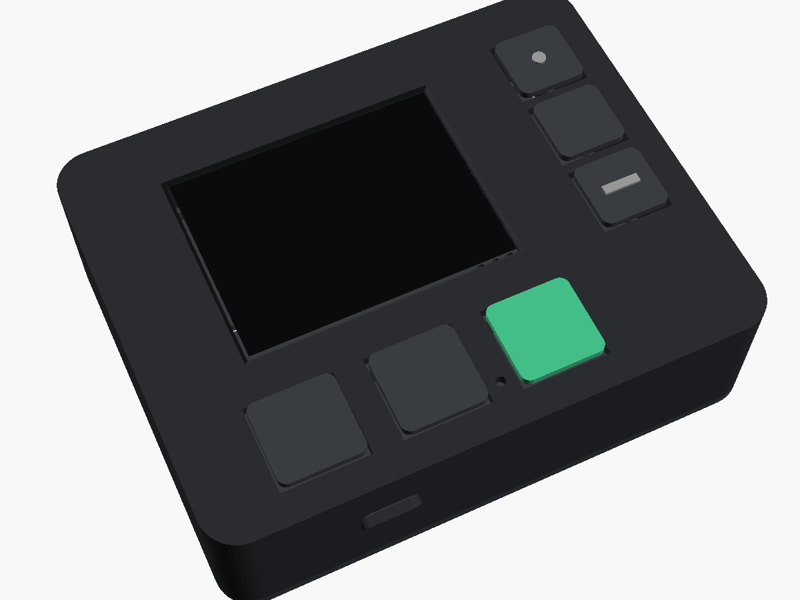
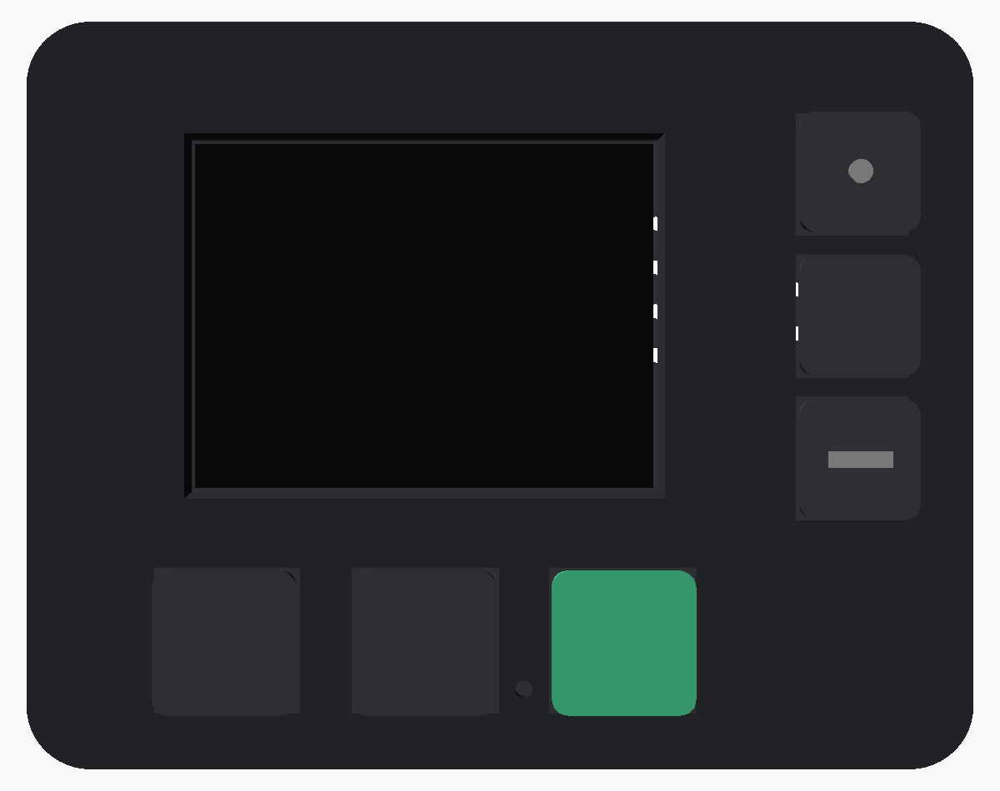

# Obudowa prototypu LUMI (ekran 2,8", kwadratowe przyciski)





Model jest parametryczny i powstał w OpenSCAD: `lumi_obudowa.scad`. Pliki do druku:

| Plik | Co to | Jak drukować |
| --- | --- | --- |
| `przod.stl` | front ze ścianami, okno ekranu, otwory przycisków | **frontem w dół**, bez podpór |
| `tyl.stl` | tylna ścianka z kratką głośnika i prowadnicami ogniwa | płasko, bez podpór |
| `przyciski.stl` | 7 nasadek: 3 prawe 15 mm, 3 dolne 18 mm, zasilanie 8 mm | **wierzchem w dół**, bez podpór |

## Wymiary

**Obudowa: 119 x 94 x 32,4 mm** (szerokość x wysokość x grubość z tylną ścianką).

Jest większa niż docelowe urządzenie (105 x 80 mm), bo w środku są gotowe moduły: płytka ESP32 na goldpinach, moduł ekranu 86 x 50 mm, SIM800L i koszyczek 18650. Wersja z własną płytką PCB będzie mniejsza i cieńsza.

**Układ frontu** (patrząc od frontu, początek w lewym dolnym rogu, wymiary w mm):

| Element | Pozycja | Rozmiar |
| --- | --- | --- |
| Okno ekranu | środek x 50,0 / y 57,0 | 58,8 x 44,4 (obraz 57,6 x 43,2 + 0,6 z każdej strony), faza 0,8 mm na zewnątrz |
| Prawa kolumna: górny / środkowy / dolny | x 104,5; y 75 / 57 / 39 | nasadki 15 x 15, rozstaw 18 |
| Dolny rząd: Muzyka / Dom / Dzwoń | y 16; x 25 / 50 / 75 | nasadki 18 x 18, rozstaw 25 |
| Mikrofon | między Domem a Dzwoń, przy dolnej krawędzi | otwór Ø 2,2 |
| USB-C (złącze COM ESP32) | dolna ściana, x 35 | 13 x 7 |
| Rolka głośności (KY-040) | prawa ściana, wysokość dolnego rzędu | otwór Ø 7,4 na gwint M7 |
| Zasilanie | górna ściana, 28 mm od prawej | nasadka 8 x 8 |
| Głośnik | tylna ścianka, prawa górna część | kratka Ø 36 |

Środkowy prawy przycisk jest na wysokości środka obrazu, a rozstaw 18 mm odpowiada etykietom na ekranie (y = 32 / 120 / 208 px przy 5,56 px/mm). Etykiety skrajnych przycisków są na ekranie około 2 mm bliżej środka niż same przyciski. To świadomy kompromis, opisany w `firmware/src/ui/Ui.cpp`.

**Znaki dotykowe na nasadkach:**
- górny prawy: kropka;
- dolny prawy: kreska;
- Dzwoń: wypukła ramka.

Te same znaki są na etykietach ekranu. Nasadkę "Dzwoń" najlepiej wydrukować z zielonego filamentu.

## Najpierw zmierz swój moduł ekranu

Moduły 2,8" różnią się między producentami. Zmierz suwmiarką i popraw sekcję `ZMIERZ` na początku pliku `.scad`:

| Parametr | Co zmierzyć | Domyślnie |
| --- | --- | --- |
| `ekran_pcb` | płytka modułu: szerokość x wysokość (piny po lewej) | 86 x 50 |
| `ekran_lcd_t` | od wierzchu płytki do wierzchu szkła | 4,2 |
| `aktywny_off` | od lewego dolnego rogu płytki do lewego dolnego rogu **świecącego obrazu** | 14,2 / 3,4 |
| `ekran_otwory` | środki 4 otworów montażowych od lewego dolnego rogu płytki | 3 / 3, 83 / 3, 3 / 47, 83 / 47 |

Jeśli coś się nie zgadza, napisz mi te 4 wymiary, a przeliczę model.

Plik sam sprawdza odstępy. Gdy po zmianie wymiarów coś na siebie nachodzi, w konsoli OpenSCAD pojawi się ostrzeżenie `UWAGA: ...`.

## Druk

- **Materiał:** PETG albo PLA. PETG jest mniej kruchy przy wkręcaniu wkrętów.
- **Warstwa:** 0,2 mm, ściany 3 obrysy, wypełnienie 25%.
- **Nasadki:** warstwa 0,12 mm, wtedy znaki dotykowe wychodzą wyraźne.
- **Luz nasadek w otworach:** 0,35 mm z każdej strony (parametr `luz`). Jeśli nasadki się zacinają, zwiększ go do 0,45. Jeśli się chwieją, zmniejsz do 0,25.

## Potrzebne do złożenia

| Część | Ile |
| --- | --- |
| Wkręty M3 x 10 samogwintujące do tworzyw (tylna ścianka) | 4 |
| Wkręty M2,5 x 6 (moduł ekranu) | 4 |
| Wkręty M2 x 5 (płytki z przyciskami) | 4 |
| Płytka uniwersalna 2,54 mm: pasek ok. 24 x 56 mm (prawa kolumna) i ok. 82 x 24 mm (dolny rząd) | 2 |
| Przyciski 12 x 12 mm THT, wysokość 7,3 mm | 6 + 1 mały (6 x 6) na zasilanie |
| Opaski zaciskowe 2,5 mm, taśma dwustronna | kilka |

## Składanie

1. Włóż nasadki od środka frontu, kołnierzem do środka.
2. Przylutuj przyciski do dwóch pasków płytki uniwersalnej, w rozstawach z tabeli (prawa kolumna co 18 mm, dolny rząd co 25 mm).
3. Przykręć paski do słupków wkrętami M2. Przyciski dociskają nasadki od środka, a kołnierz nie pozwala im wypaść.
4. Włóż moduł ekranu szkłem w gniazdo frontu i przykręć go do 4 słupków.
5. Mały przycisk zasilania 6 x 6 przylutuj do skrawka płytki uniwersalnej i przyklej go klejem na gorąco od środka górnej ściany, popychaczem w nasadkę 8 x 8.
6. Rolkę KY-040 przełóż gwintem przez otwór w prawej ścianie i dokręć nakrętką.
7. ESP32 i SIM800L przymocuj do tylnej ścianki opaskami (są na nie wycięcia) albo taśmą. Złącze COM ESP32 ustaw na wysokości wycięcia USB-C.
8. Koszyczek 18650 włóż między prowadnice na tylnej ściance.
9. Zamknij tylną ściankę 4 wkrętami M3.

## Zmiany w modelu

Parametry na początku pliku pozwalają zmienić m.in.:
- rozmiar nasadek (`nasadka_bok`, `nasadka_dol`);
- rozstawy (`rozstaw_bok`, `rozstaw_dol`);
- marginesy i grubość obudowy (`glebokosc`);
- położenie USB, rolki i zasilania.

Pliki STL i podglądy generuje się poleceniami:

```
openscad -D 'czesc="przod"' -o przod.stl lumi_obudowa.scad
openscad -D 'czesc="tyl"' -o tyl.stl lumi_obudowa.scad
openscad -D 'czesc="przyciski"' -o przyciski.stl lumi_obudowa.scad
openscad -D 'czesc="zlozenie"' --preview --imgsize=1200,900 --camera=60,50,0,30,0,-25,330 -o podglad.png lumi_obudowa.scad
```
