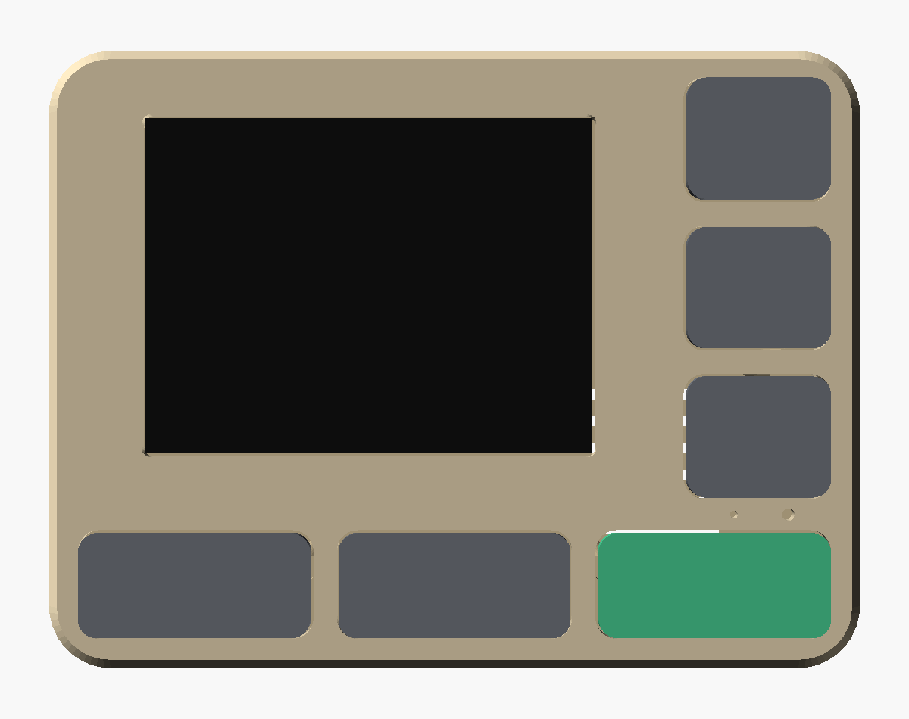
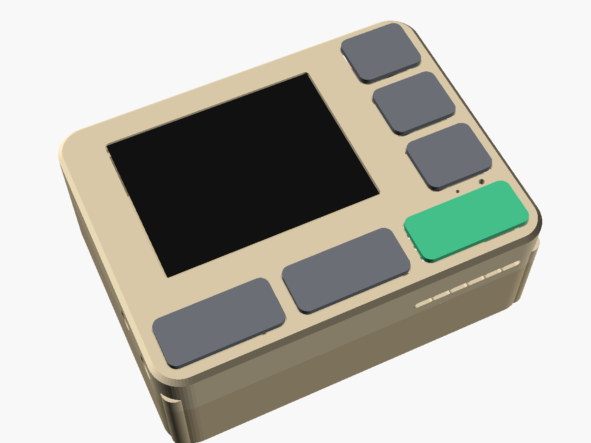

# Obudowa LUMI v3 (na podstawie lumi_p_v2.2)





Model `lumi_v3.scad` (OpenSCAD) przenosi projekt **lumi_p_v2.2** (Creality Print, 23.11.2026) i dodaje to, czego v2.2 nie miał w środku.

## Co jest z v2.2 (przeniesione 1:1)

Wymiary odczytałem z przekrojów twojego pliku 3MF. Płyta frontu zgadza się z dokładnością do 0,01 mm (pola otworów są identyczne). Wycięcia w ścianach zgadzają się z dokładnością około 0,3 mm.

| Element | Wymiar (patrząc od frontu, środek w 0,0) |
| --- | --- |
| Obudowa | 105 x 80 mm, narożniki R8, front 15 mm, przednia krawędź zaokrąglona |
| Płyta frontu / ściany | 2,0 / 1,8 mm |
| Okno ekranu | 58,6 x 44,2 mm, środek (-11,0; 9,5), narożniki R1,2 |
| Prawa kolumna | 3 otwory 19 x 16,13 mm, x 39, y 28,3 / 9,2 / -9,9, narożniki R2,7 |
| Dolny rząd | 3 otwory 30,33 x 14 mm, y -29, x -33,3 / 0 / 33,3, narożniki R2,7 |
| Otwory we froncie | Ø1,6 w (43; -20) i Ø1,0 w (36; -20) |
| Górna ściana | wycięcie około 6 mm przy x -36,5 i podłużne 16 mm przy x 35 |
| Lewa ściana | dwa wycięcia około 6 mm przy y -13 i -27 |
| Dolna ściana | 6 szczelin 2,4 mm (kratka) przy x od 16,7 do 41,7 |
| Wycięcia w ścianach | środek 10,4 mm od frontu, wysokość 5,8 mm, zaokrąglone końce |
| Wkręty | 4 w narożnikach (±48,6; ±36,1) |
| Tył | taca 105 x 80 mm, ściany 2,7 mm, kołnierz 1,39 mm z wolnymi narożnikami, 6 szczelin 22 x 1,6 mm |

Nie wiem, do czego służą wycięcia w ścianach. W modelu opisałem je jako zasilanie, rolkę i porty. Jeśli było inaczej, napisz, poprawię opisy i wymiary.

## Co nowego w v3

| Zmiana | Po co |
| --- | --- |
| **Nasadki** do twoich otworów: 3 x 18,4 x 15,5 mm (prawa kolumna) i 3 x 29,7 x 13,4 mm (dolny rząd), luz 0,3 mm | przyciski mają kształt twoich otworów |
| **Znaki dotykowe** na nasadkach | górny prawy: kropka; dolny prawy: kreska; "Dzwoń": wypukła ramka. Te same znaki są na ekranie |
| **Kołnierz nasadki** 1 mm | nasadka nie wypada; między otworami jest tylko 3 mm, więcej się nie zmieści |
| **Półki na płytki z przyciskami** przy prawej i dolnej ścianie | płytki leżą na właściwej głębokości (przyciski 12 x 12 THT, 7,3 mm) |
| **Słupki dociskowe w tylnej ściance** | po zamknięciu obudowy dociskają płytki z przyciskami do półek; we froncie nie ma miejsca na słupki |
| **Wkręty od tyłu** (łeb stożkowy w tylnej ściance, otwór pod M3 w narożnych słupkach frontu) | z frontu nie widać wkrętów |
| **Dwa warianty tyłu** | `tyl_docelowy.stl`: 7,5 mm jak w v2.2, do wersji z własną płytką PCB. `tyl_prototyp.stl`: 22 mm, żeby zmieściły się ESP32 na goldpinach, SIM800L i ogniwo 18650 |

**Grubość:** wariant docelowy 22,5 mm (jak v2.2), prototyp 37 mm.

W wariancie docelowym (wnętrze około 18,5 mm) moduły z prototypu się nie zmieszczą. Samo ogniwo 18650 w koszyczku ma około 20 mm. Do takiej grubości trzeba płaskiego akumulatora (np. LiPo 103450: 10 x 34 x 50 mm) i własnej płytki z modułem ESP32-S3 zamiast płytki DevKit.

## Do ustalenia: który ekran?

W v2.2 okno ma 58,6 x 44,2 mm, czyli obraz 2,8" z marginesem 0,5 mm. **Moduł 2,8", który teraz masz (płytka około 86 x 50 mm), nie zmieści się w tej obudowie:**
- przy oknie przesuniętym w lewo wystaje poza lewą ścianę;
- wchodzi pod prawą kolumnę przycisków.

Dlatego **v3 nie ma jeszcze mocowania ekranu.** Podaj, jaki ekran ma być w tej obudowie: link do aukcji albo wymiary płytki, położenie świecącego obrazu na płytce i otwory montażowe. Dodam do niego ramkę albo słupki.

## Pliki

| Plik | Druk |
| --- | --- |
| `przod.stl` | frontem w dół, bez podpór; wycięcia w ścianach mostkują się w poziomie (do 16 mm, PETG i PLA dają radę) |
| `tyl_prototyp.stl` / `tyl_docelowy.stl` | dnem w dół, bez podpór |
| `przyciski.stl` | 6 nasadek, wierzchem w dół |

**Druk:** PETG albo PLA, warstwa 0,2 mm, 3 obrysy, wypełnienie 25%. Nasadki warstwą 0,12 mm, wtedy znaki dotykowe wychodzą wyraźnie.

## Składanie

1. Włóż nasadki od środka frontu.
2. Przyciski 12 x 12 przylutuj do dwóch pasków płytki uniwersalnej, w położeniach otworów:
   - prawa kolumna: x 39, y 28,3 / 9,2 / -9,9;
   - dolny rząd: y -29, x -33,3 / 0 / 33,3.

   W pasku prawej kolumny **zetnij prawy górny róg** (około 8 x 8 mm), bo jest tam słupek wkrętu.
3. Połóż paski na półkach przyciskami w stronę frontu.
4. Zamknij tył: słupki dociskowe przytrzymają paski.
5. Wkręty:
   - wariant docelowy: 4 wkręty M3 x 12 samogwintujące do tworzyw;
   - prototyp: 4 wkręty M3 x 28.

## Zmiany w modelu

Na początku `lumi_v3.scad` są wszystkie wymiary z v2.2 i nowe parametry, m.in.:
- `luz` (luz nasadek);
- `kolnierz_wysieg`;
- `tyl_h` przez `wariant` (docelowy albo prototyp);
- lista `wyciecia` w ścianach.

Polecenia:
```
openscad -D 'czesc="przod"' -o przod.stl lumi_v3.scad
openscad -D 'czesc="tyl"' -D 'wariant="prototyp"' -o tyl_prototyp.stl lumi_v3.scad
openscad -D 'czesc="tyl"' -D 'wariant="docelowy"' -o tyl_docelowy.stl lumi_v3.scad
openscad -D 'czesc="przyciski"' -o przyciski.stl lumi_v3.scad
```
